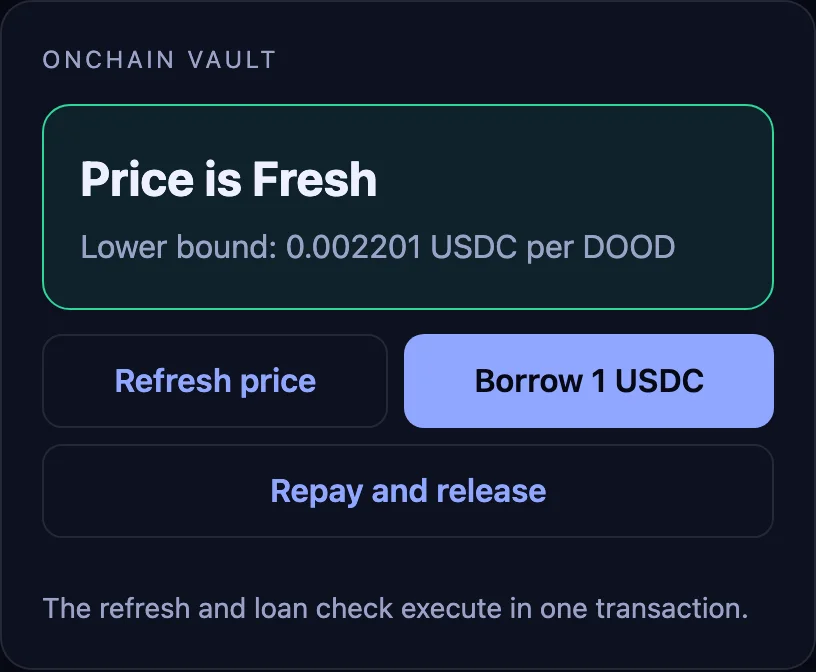
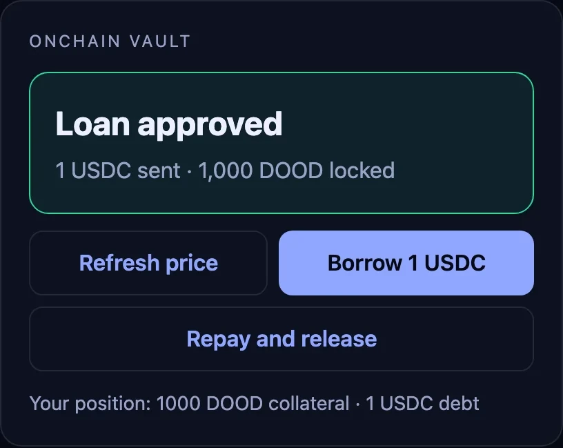
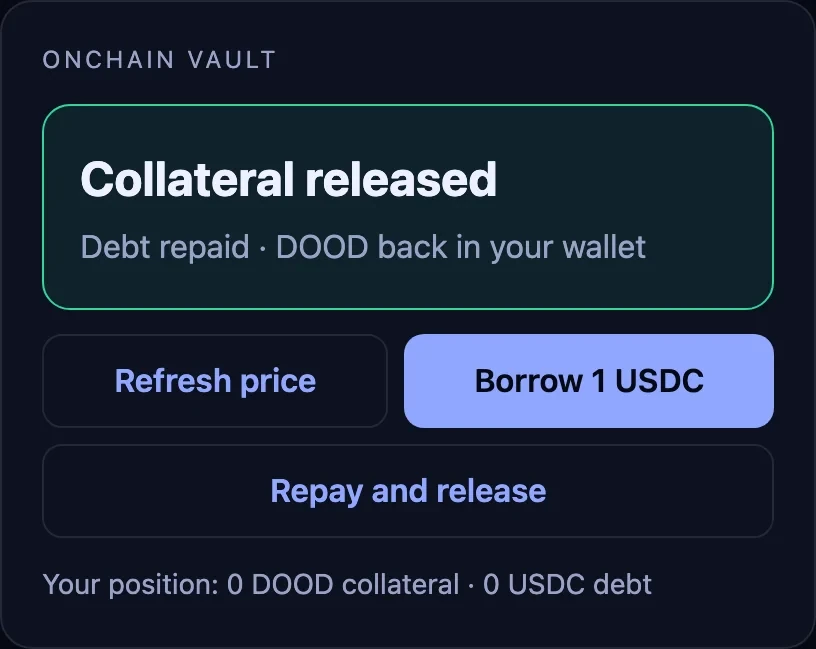

# Lend against any token

> [!WARNING]
> **Demonstration only, not audited.** This code shows how a program reads a Mimir price. Don't deploy or use it as-is with real funds.
>
> The tokens shown here (DOOD and others) are examples only. Mimir doesn't support, endorse or recommend any token mentioned.

Borrow USDC against a token, valued at Mimir's lower bound.

<table><tr><td width="33%"><a href="../../assets/01-step1.webp"></a></td><td width="33%"><a href="../../assets/01-step2.webp"></a></td><td width="33%"><a href="../../assets/01-step3.webp"></a></td></tr><tr><td>1. Refresh price. Mimir is Fresh, with a lower bound of 0.002201 USDC per DOOD.</td><td>2. Borrow. 1 USDC against 1,000 DOOD, checked at the lower bound in the same transaction.</td><td>3. Repay and release. The debt goes back to 0 and the DOOD returns to the wallet.</td></tr></table>

Recorded on a local validator cloned from mainnet, with DOOD as collateral.

The vault refreshes Mimir inside the borrow transaction and lends up to 90% of the collateral valued at Mimir's lower bound. If the price is not Fresh, the loan is declined and no token moves. Repay returns the USDC debt, and release returns the collateral once the debt is zero; neither step reads a price. Liquidation is out of scope: this is a teaching vault, not a lending protocol.

```rust
fresh(feed, sys)?;
let lower = u128_at(&feed.try_borrow()?, 216)? >> 32;
if loan as u128 > loan_limit(deposit, lower, decimals, LTV_BPS)? { return Err(LIMIT); }
```

```ts
await borrow(connection, wallet, 1_000_000_000_000n, 1_000_000n); // 1,000 DOOD in, 1 USDC out
await settle(connection, wallet, 3, 1_000_000n);                  // repay
await settle(connection, wallet, 4);                              // release the collateral
```

Measured in the recorded run:

- **Refresh + borrow:** 75,471 CU, 22 accounts (11 for the consumer), 1 signature, 5,000 lamports. The first borrow also opens a 16-byte position account.
- **Repay or release:** about 9,550 CU, 12 accounts, 5,000 lamports.
- **Price not Fresh:** the consumer returns error 1 and the transaction changes nothing.

Run `npm run preflight`, then `npm run dev -w 01-lend-against-any-token`. **Refresh price** reads mainnet through your `VITE_RPC_URL`; borrow and repay need [`programs/mimir-cookbook`](../../programs/mimir-cookbook): run them on a local copy of mainnet with `npm run localnet` (see the [root README](../../README.md#run)). The app sizes the collateral at twice the 1 USDC loan, at the lower bound.
