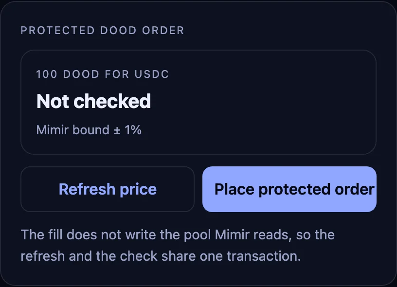
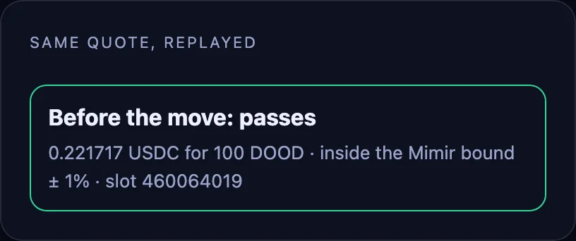
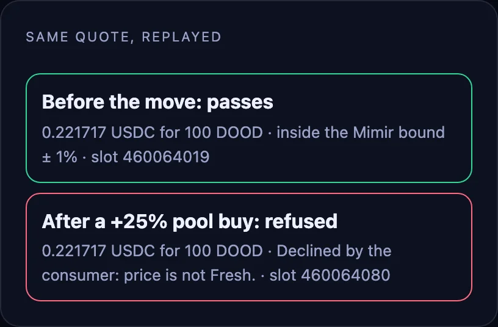

# Fair-price order

> [!WARNING]
> **Demonstration only, not audited.** This code shows how a program reads a Mimir price. Don't deploy or use it as-is with real funds.
>
> The tokens shown here (DOOD and others) are examples only. Mimir doesn't support, endorse or recommend any token mentioned.

A maker fill that pays only when the price sits inside Mimir's bound.

<table><tr><td width="33%"><a href="../../assets/02-step1.webp"></a></td><td width="33%"><a href="../../assets/02-step2.webp"></a></td><td width="33%"><a href="../../assets/02-step3.webp"></a></td></tr><tr><td>1. The order. A maker offers USDC for 100 DOOD; the program checks Mimir's bound in the same transaction.</td><td>2. Before the move. The 0.221717 USDC quote sits inside the bound and passes.</td><td>3. After a +25% pool buy. The same quote is refused: the price is not Fresh.</td></tr></table>

Recorded on a local validator cloned from mainnet, with DOOD.

A maker buys 100 DOOD, and the program refreshes Mimir and pays only between 99% of the lower bound and 101% of the upper bound. The same quote passed before a 25% pool buy and was refused after it, in recorded simulations. A Mimir refresh cannot share a transaction with a write to its source pool, so this is a maker exchange, not a swap through that pool.

```rust
fresh(feed, sys)?;
let f = feed.try_borrow()?;
let (lower, upper) = (u128_at(&f, 216)? >> 32, u128_at(&f, 232)? >> 32);
let minimum = mul(loan_limit(deposit, lower, decimals, 10000)?, 9900)? / 10000;
let maximum = mul(loan_limit(deposit, upper, decimals, 10000)?, 10100)? / 10000;
if (loan as u128) < minimum || loan as u128 > maximum { return Err(ORDER); } // loan = USDC paid
```

```ts
await fill(connection, wallet, 100_000_000_000n, payout); // 100 DOOD in, payout USDC atoms out
```

Measured in the recorded run:

- **Refresh + fill:** 73,623 CU in simulation, 9 program accounts, 1 signature, 5,000 lamports.
- **Price not Fresh:** the program returns error 1 and no token moves.

Run `npm run preflight`, then `npm run dev -w 02-fair-price-order`. **Refresh price** reads mainnet through your `VITE_RPC_URL`, and the recorded replay needs no RPC; placing an order needs your own deployment of [`programs/mimir-cookbook`](../../programs/mimir-cookbook) (`VITE_CONSUMER`). The app sizes the order at about 1 USDC.
