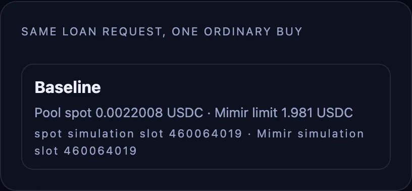
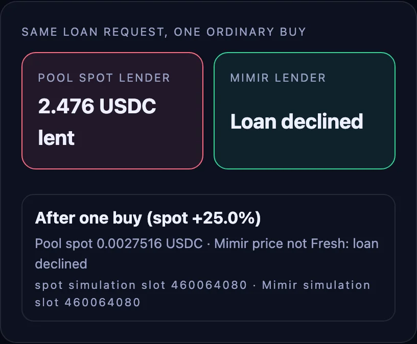
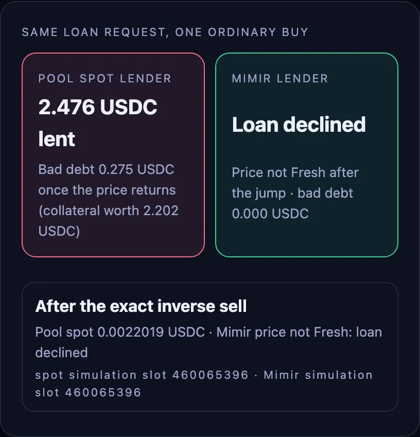

# Price shock: spot vs Mimir

> [!WARNING]
> **Demonstration only, not audited.** This code shows how a program reads a Mimir price. Don't deploy or use it as-is with real funds.
>
> The tokens shown here (DOOD and others) are examples only. Mimir doesn't support, endorse or recommend any token mentioned.

## What it shows

Two lenders value the same 1,000 DOOD at 90% LTV. One reads the pool spot, the other Mimir's
refreshed lower bound. After one ordinary +25% buy the spot lender lends more and keeps bad debt
when the price returns; the Mimir lender declines. The page replays three snapshots recorded on a
local validator cloned from mainnet.

<table><tr><td width="33%"><a href="../../assets/03-step1.webp"></a></td><td width="33%"><a href="../../assets/03-step2.webp"></a></td><td width="33%"><a href="../../assets/03-step3.webp"></a></td></tr><tr><td>1. Baseline. Both lenders allow 1.981 USDC on 1,000 DOOD.</td><td>2. After one +25% buy. The spot lender lends 2.476 USDC; the Mimir lender declines.</td><td>3. After the price returns. The spot lender holds 0.275 USDC of bad debt; the Mimir lender holds none.</td></tr></table>

Recorded on a local validator cloned from mainnet, with DOOD.

On the local validator, one 34,839 USDC buy lifted the DOOD pool spot by 25%, and an exact inverse sell brought it back; a buy that inflates the collateral is the adverse case for a lender. Both lenders got the same 1,000 DOOD request at 90% LTV: the spot lender lent 2.476 USDC, 0.275 USDC more than the collateral was worth once the price returned. Mimir marked the price not Fresh after the jump, so the Mimir lender declined and holds no bad debt. The app replays the three recorded snapshots, baseline, after the buy and after the restore, and shows every simulation slot. Both checks run onchain.

## Run it on your machine

**Prerequisites** (tested versions in brackets):

- Node.js 22.6 or later, with npm 10 or later [Node 24.20, npm 11.19]
- Rust with `rustup` [rustc 1.98]
- The Agave (Solana) CLI, which brings `solana-test-validator` and `cargo build-sbf`
  [solana-cli 4.2, cargo-build-sbf 4.1]: https://docs.anza.xyz/cli/install
- A mainnet RPC endpoint of your own (any provider) is recommended: the public one is rate limited.

This recipe replays recorded snapshots, so it runs without the program: steps 4 to 6 are optional (do them to try recipes 01 and 02 too).

**Steps**, from an empty folder:

1. Get the code.

   ```bash
   git clone https://github.com/QuantuLabs/mimir-cookbook.git
   cd mimir-cookbook
   ```

2. Install the dependencies.

   ```bash
   npm ci
   ```

   You should see `added … packages` and no error.

3. Check the feed on mainnet (read-only: it simulates a refresh, signs nothing).

   ```bash
   npm run preflight
   ```

   You should see a JSON report with `"refresh": { … "fresh": true … }` and `"failures": []`.

4. Build the program.

   ```bash
   (cd programs/mimir-cookbook && cargo build-sbf)
   ```

   You should see `Finished release`. It writes `programs/mimir-cookbook/target/deploy/mimir_cookbook.so`
   and the program keypair next to it.

5. Start a local validator cloned from mainnet. Leave it running in its own terminal.

   ```bash
   RPC=<your mainnet RPC URL> npm run localnet
   ```

   Without `RPC` it clones from the public endpoint. It clones Mimir, the feed and its pools, loads
   your program, creates a throwaway test wallet in `.localnet/test-wallet.json` (gitignored) and
   funds it with SOL, the feed's token and the vaults with USDC. You should see:

   ```text
   Local test wallet (.localnet/test-wallet.json): <address>
   Add to .env.local, then run an app:
   VITE_RPC_URL=http://127.0.0.1:8899
   VITE_CONSUMER=<your program address>
   ```

   then the validator's status line. To fund your own wallet instead, pass its address:
   `npm run localnet -- <your wallet address>`.

6. In a second terminal, create `.env.local` at the repository root with the two lines it printed.

   ```bash
   printf 'VITE_RPC_URL=http://127.0.0.1:8899\nVITE_CONSUMER=<your program address>\n' > .env.local
   ```

7. Run the app.

   ```bash
   npm run dev -w 03-price-shock-spot-vs-mimir
   ```

   Open the URL it prints. You should see *POOL SPOT LENDER: 2.476 USDC lent, bad debt 0.275 USDC* and *MIMIR LENDER: Loan declined, price not Fresh after the jump*, then the three snapshots (baseline, after one buy at +25.0%, after the inverse sell).

**Troubleshooting**

- *"This RPC endpoint refuses browser requests"*: the public mainnet endpoint serves scripts but
  not browsers. Set `VITE_RPC_URL` in `.env.local` to your own endpoint, or to the localnet URL.
- *The price is no longer Fresh after a minute or two on localnet*: expected. Nothing trades on the
  local copy, so the Mimir price ages out and the program declines, as it should. Stop the validator
  (Ctrl-C) and run `npm run localnet` again to clone current pools.
- *A port is busy* (`Address already in use`): another validator is running. Pick free ports, then
  use the new RPC port in `.env.local`:

  ```bash
  LOCALNET_ARGS="--rpc-port 8999 --faucet-port 9999 --gossip-port 8100 --dynamic-port-range 8110-8140" npm run localnet
  ```

- *No wallet extension signs on localhost*: use **Use the local test wallet**. It appears only when
  `VITE_RPC_URL` is a localhost URL. The vite dev server serves the key from `.localnet/`; a build
  never contains it, and the server refuses it for any other RPC. Browser wallets (Solflare,
  Phantom, Backpack) stay available for mainnet reads and your own deployments.

## How it works

1. **Two instructions, one program.** Tag 0 (`Tag.MimirBorrow`) values the collateral at Mimir's
   lower bound after [`check_fresh()`](../../programs/mimir-cookbook/src/lib.rs); tag 2 (`Tag.SpotLender`) values it with
   [`spot_price()`](../../programs/mimir-cookbook/src/lib.rs), the reserves of the feed's CPMM pool. Both go through the same
   [`loan_limit()`](../../programs/mimir-cookbook/src/lib.rs) and the same check in [`borrow()`](../../programs/mimir-cookbook/src/lib.rs):

   ```rust
   let price_q32 = if let [pool, base_vault, quote_vault] = extra {
       spot_price(feed_account, pool, base_vault, quote_vault)?
   } else {
       mimir_lower_bound(feed_account, sysvar)?
   };
   ```

2. **The recording.** [`checkBorrow()`](../../packages/mimir-easy/src/consumer.ts) built and simulated both requests at each
   snapshot (unsigned simulations); the results are in
   [`fixtures/dood-shock`](../../fixtures/dood-shock).
3. **The comparison.** [`showComparison()`](src/main.ts) takes the spot lender's limit after the
   buy, and the collateral's value after the inverse sell, to compute the bad debt:

   ```ts
   const badDebt = Math.max(0, lent - valueAfterSell);
   ```

   The Mimir lender's request after the jump failed with error 1 (*price is not Fresh*): no loan,
   no bad debt.
4. **Check it yourself.** `npm run preflight` re-checks these recorded results and prints them
   under `recorded`.

Measured in the recorded run:

- **Spot lender:** 20,905 CU. **Refresh + Mimir lender:** 73,999 CU, both simulated at slot 460064019.
- **Price not Fresh:** the Mimir lender returns error 1 and no token moves.
